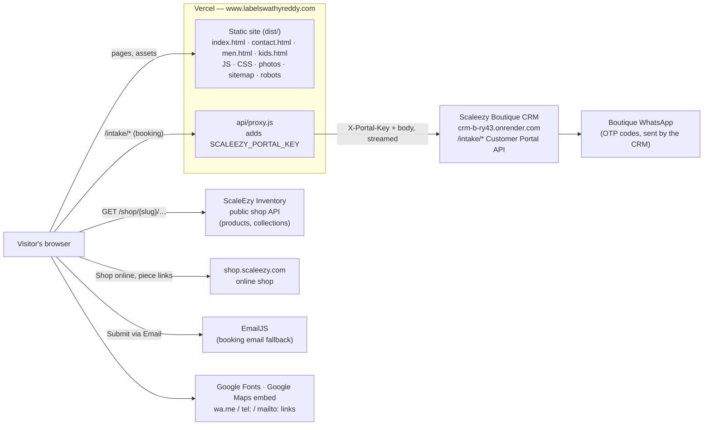

# Swathy Reddy Designer Studio — website architecture

**Live:** https://www.labelswathyreddy.com (Vercel; `labelswathyreddy.com` redirects to `www`)
**Repo:** github.com/DomsGlobal9/swathy-reddy-designer-studio — pushes to `main` deploy to production.
**Built by:** Doms Global LLP.

The site is a single-page React app served as static files by Vercel, plus one small server
function. It owns no database: products come from ScaleEzy Inventory, bookings go to the
Scaleezy Boutique CRM, and contact details live in one file in the repo.



## Pages

| Address | Page | Notes |
|---|---|---|
| `/` | `src/pages/Home.tsx` | The long scroll story: Hero → Woman / Men / Kids → Story → Weave band → Craft → Collection showcase → Signature edit → Follow the thread → Occasions → Lookbook → Personal styling. Opening animation (`Preloader`) only here, skipped when arriving at a section (`/#men`). |
| `/contact` | `src/pages/Contact.tsx` | Live open/closed badge, ways to reach (visit, write, call/WhatsApp, consult), weekly hours, rose-tinted map with the exact pin. |
| `/men`, `/kids` | `src/pages/ComingSoon.tsx` | Heritage Collection posters, WhatsApp "notify me". |
| anything else | `src/pages/NotFound.tsx` | Friendly 404, `noindex`. |

Routing is a path check in `src/App.tsx` (no router library: four fixed pages). Every page shares
`SiteHeader`, `SiteFooter` and the `BookingDialog`.

## Where data comes from

| Data | Source | Code |
|---|---|---|
| Products, prices, photos, collections | ScaleEzy Inventory public shop API (`VITE_SHOP_API`, defaults to `inventory-backend-1-ym8d.onrender.com/shop/swathy-reddy-designer-studio`). Read-only, no key. | `src/lib/shop.ts`, `src/context/ShopData.tsx` |
| Contact details, hours, map pin | `src/data/contact.ts` — the one place to edit. Header, footer, contact page and error messages read it. | `src/data/contact.ts` |
| Garments the CRM offers, their measurements and photo parts | CRM `GET /intake/products/…` via the proxy | `src/lib/scaleezyPortal.ts` |
| Brand copy, sections, images | Repo | `src/data/*.ts`, `public/` |

`ShopData` loads once, picks a cover per collection without repeating any photo on the page, and
shows designed empty frames while loading or a link to the shop if it can't be reached.

## Booking (Private Consultation)

`src/components/BookingDialog.tsx`, three steps: **Consultation** (name, mobile, date, mode) →
**The Outfit** (one or more garments, each with fabric, craft, design notes) → **Measurements**
(a tab per garment: the CRM's own size fields and design-photo slots via `DesignPhotos`).

Sending (Scaleezy Customer Portal API v1.1):

1. `POST /intake/customer/verify/request/` — the CRM sends a WhatsApp code from the boutique's number.
2. `POST /intake/customer/verify/` — returns a token valid 15 minutes.
3. `POST /intake/customer/` — the customer's details (uses the token up for details).
4. `POST /intake/customer/product/` — **one per garment** (the CRM accepts one product per
   requirement; measurements and photo parts must belong to it), all with the same token.
   Photos go as multipart `images[<part>]`; sizes in inches (cm converted).

A retry after a partial failure resends only what didn't arrive. **Submit via Email** sends the same
request through EmailJS (`src/lib/email.ts`) instead.

### Why there is a server function

`api/proxy.js` (Vercel function) receives `/intake/*` (rewrite in `vercel.json`), adds the portal
key from the server-only env var `SCALEEZY_PORTAL_KEY` and streams the request to the CRM
unchanged, so:

- the key never reaches the browser (no `VITE_` prefix: Vite would bundle it);
- the browser talks to its own origin, so the CRM needs no CORS set-up;
- photo uploads pass through untouched.

Vercel limits a function request to **4.5 MB**, so `src/lib/shrinkPhotos.ts` shrinks design photos
in the browser only when one booking's photos exceed ~4 MB, largest first, just enough to fit.
Locally, `vite.config.ts` does the proxy's job (`npm run dev`).

## Search and sharing

| Piece | Where |
|---|---|
| Titles, descriptions, Open Graph / Twitter previews, canonical | `index.html` (home) + `scripts/seo-pages.mjs`, which after `vite build` writes `dist/contact.html`, `men.html`, `kids.html` with each page's own tags — link previews never run JavaScript. `cleanUrls` in `vercel.json` serves `/contact` from `contact.html`. |
| Share image | `public/og-image.jpg` (1200×630, Women · Men · Kids); men/kids use their posters |
| Business details for Google (ClothingStore: address, phone, hours, geo, map) | JSON-LD in `index.html` — keep in step with `src/data/contact.ts` |
| Sitemap / robots | `public/sitemap.xml`, `public/robots.txt` (blocks `/api/`, `/intake/`) |
| Icons | `favicon.ico`, `favicon-32.png`, `apple-touch-icon.png`, `icon-192/512.png`, `site.webmanifest` |

**Adding a page:** add it to `src/App.tsx`, `scripts/seo-pages.mjs` and `public/sitemap.xml`.

## Configuration

| Variable | Where | What |
|---|---|---|
| `SCALEEZY_PORTAL_KEY` | Vercel (server only) and local `.env` | Portal API key; identifies the boutique in the CRM. **Never** prefix with `VITE_`. |
| `SCALEEZY_BASE_URL` | optional | CRM address (default `https://crm-b-ry43.onrender.com`). |
| `VITE_SHOP_SLUG`, `VITE_SHOP_URL`, `VITE_SHOP_API` | optional | Point the site at another shop. |
| `VITE_EMAILJS_SERVICE_ID`, `VITE_EMAILJS_TEMPLATE_ID`, `VITE_EMAILJS_PUBLIC_KEY` | Vercel | Email fallback (public by design). |
| `VITE_SCALEEZY_DEMO=true` | local only | Offline demo of the booking flow with fake codes. |

## Stack

React 18 + TypeScript, Vite 5, Tailwind CSS 3, Framer Motion (scroll and reveal animation), Lenis
(smooth scroll), lucide-react icons, Bodoni Moda + Jost (Google Fonts). Hosting: Vercel (static +
one Node function). No database, no login.

## Folder map

```
api/proxy.js            the CRM proxy (Vercel function)
scripts/seo-pages.mjs   per-page HTML after the build
public/                 photos, posters, icons, og-image, sitemap, robots, manifest
src/App.tsx             page switch
src/pages/              Home, Contact, ComingSoon, NotFound
src/components/         SiteHeader, SiteFooter, BookingDialog, DesignPhotos, ProductCard, ThreadOverlay
  sections/             the home page's sections
  ui/                   small shared pieces (ArrowLink, FadeUp, OpenNow, Preloader, RevealImage…)
  craft/                garment construction drawings
src/lib/                shop.ts (Inventory), scaleezyPortal.ts (CRM), email.ts, shrinkPhotos.ts
src/data/               contact.ts, images.ts, story.ts, catalog.ts, motifs.ts, countryCodes.ts
src/context/ShopData.tsx  products and collections for the home page
```
