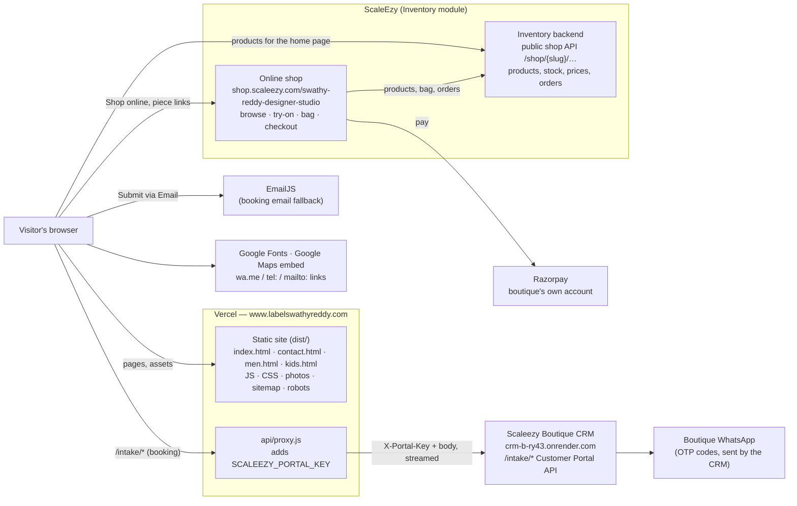

# Swathy Reddy Designer Studio — website architecture

**Live:** https://www.labelswathyreddy.com (Vercel; `labelswathyreddy.com` redirects to `www`)
**Repo:** github.com/DomsGlobal9/swathy-reddy-designer-studio — pushes to `main` deploy to production.
**Built by:** Doms Global LLP.

The site is a single-page React app served as static files by Vercel, plus one small server
function. It owns no database: products come from ScaleEzy Inventory, purchases happen on the
ScaleEzy online shop, bookings go to the Scaleezy Boutique CRM, and contact details live in one
file in the repo.



## A customer's visit, step by step

What happens behind the scenes when someone opens the site, for example from a WhatsApp link.

1. **The link is shared.** WhatsApp reads the page's preview tags (no JavaScript) and shows the
   branded card: `og-image.jpg` for home and contact, the Heritage posters for `/men` and `/kids`.
2. **The page opens.** Vercel serves the static page for that address (`index.html`,
   `contact.html`, `men.html` or `kids.html`) with the JS, CSS and photos. On the home page the
   3-second opening animation plays (skipped when arriving at a section such as `/#men`).
3. **The collections fill in.** The browser asks ScaleEzy Inventory's public shop API for the
   boutique's products and collections (`src/context/ShopData.tsx`). While it answers, the sections
   show empty frames; if it can't be reached, they offer the online shop instead.
4. **The customer explores.** The home page tells the story (Woman / Men / Kids, Story, Craft,
   Collection showcase, Signature edit, Follow the thread, Occasions, Lookbook, Personal styling).
   Men and Kids have **Explore the collection**, which opens their coming-soon pages.
5. **Then one of four things:**
   - **Buys** — *Shop online*, a collection's *Explore*, or a piece in the Signature edit opens the
     ScaleEzy online shop (next section). The purchase happens there, not on this site.
   - **Books a consultation** — *Book an appointment* opens the booking form; on submit the CRM
     sends a WhatsApp code, the customer types it, and the customer plus one requirement per garment
     land in the Boutique CRM (see **Booking**). Or *Submit via Email* sends it by EmailJS.
   - **Gets in touch** — the Contact page: live open/closed badge, Get directions (Google Maps
     listing), Call / WhatsApp (`tel:`, `wa.me`), Send an email, Copy.
   - **Waits for Men or Kids** — *Notify me on WhatsApp* opens a chat with the boutique with the
     message already written ("Please let me know when the men's collection launches").
6. **Found by search.** Google reads the sitemap, each page's title and description, and the
   ClothingStore business details (address, hours, phone, map pin) for local results and Maps.

## Shop online (shop.scaleezy.com)

The boutique's online shop is ScaleEzy's own storefront, not part of this repo (it lives in the
ScaleEzy Inventory project, `backend/shop`). This site links to it: *Shop online* in the header and
footer, the hero's *Explore collection*, *Shop the women's collection* on the coming-soon pages,
collection links (`listUrl()` with a fabric or craft filter) and piece links in the Signature edit
(`pieceUrl(code)`), all from `src/lib/shop.ts`. Address: `VITE_SHOP_URL`, default
`https://shop.scaleezy.com/swathy-reddy-designer-studio`.

What a shopper can do there:

| Step | What happens | Shop API (Inventory backend) |
|---|---|---|
| Browse | Shop home, filters, product pages with photos, colours and sizes; "also bought" | `GET /shop/{slug}`, `/products`, `/products/{code}`, `/also-bought` |
| Virtual try-on | Try a piece on their own photo | `/products/{code}/tryon` |
| Delivery check | Does the boutique deliver to this pincode? | `/delivers/{pincode}` |
| Bag | Kept in the shopper's browser; prices, stock and coupons re-checked by the server | `/bag` |
| Out of stock | "Tell the shop" to be told when it's back | `/interest` |
| Checkout | Verify the phone with a code, pick or save an address | `/verify/send`, `/verify/check`, `/addresses` |
| Pay | Razorpay checkout; the money goes to the boutique's own Razorpay account | `/pay`, `/pay/{token}/confirm` |
| Order | The order becomes a sale in ScaleEzy Inventory (stock goes down); the shopper can see or cancel it and list past orders | `/orders`, `/orders/{token}`, `/orders/{token}/cancel` |

Shipping is handled in ScaleEzy (the Logistics module). The boutique sees online orders and
stock in ScaleEzy, the same place its products and prices are managed, so the website and the shop
never disagree on what's available.

## Pages

| Address | Page | Notes |
|---|---|---|
| `/` | `src/pages/Home.tsx` | The long scroll story: Hero → Woman / Men / Kids → Story → Weave band → Craft → Collection showcase → Signature edit → Follow the thread → Occasions → Lookbook → Personal styling. Opening animation (`Preloader`) only here, skipped when arriving at a section (`/#men`). |
| `/contact` | `src/pages/Contact.tsx` | Live open/closed badge, ways to reach (visit, write, call/WhatsApp, consult), weekly hours, rose-tinted map with the exact pin. |
| `/men`, `/kids` | `src/pages/ComingSoon.tsx` | Heritage Collection posters, WhatsApp "notify me". |
| anything else | `src/pages/NotFound.tsx` | Friendly 404, `noindex`. |

Routing is a path check in `src/App.tsx` (no router library: four fixed pages). Every page shares
`SiteHeader`, `SiteFooter` and the `BookingDialog`.

## Where data comes from

| Data | Source | Code |
|---|---|---|
| Products, prices, photos, collections | ScaleEzy Inventory public shop API (`VITE_SHOP_API`, defaults to `inventory-backend-1-ym8d.onrender.com/shop/swathy-reddy-designer-studio`). Read-only, no key. | `src/lib/shop.ts`, `src/context/ShopData.tsx` |
| Contact details, hours, map pin | `src/data/contact.ts` — the one place to edit. Header, footer, contact page and error messages read it. | `src/data/contact.ts` |
| Garments the CRM offers, their measurements and photo parts | CRM `GET /intake/products/…` via the proxy | `src/lib/scaleezyPortal.ts` |
| Brand copy, sections, images | Repo | `src/data/*.ts`, `public/` |

`ShopData` loads once, picks a cover per collection without repeating any photo on the page, and
shows designed empty frames while loading or a link to the shop if it can't be reached.

## Booking (Private Consultation)

`src/components/BookingDialog.tsx`, three steps: **Consultation** (name, mobile, date, mode) →
**The Outfit** (one or more garments, each with fabric, craft, design notes) → **Measurements**
(a tab per garment: the CRM's own size fields and design-photo slots via `DesignPhotos`).

Sending (Scaleezy Customer Portal API v1.1):

1. `POST /intake/customer/verify/request/` — the CRM sends a WhatsApp code from the boutique's number.
2. `POST /intake/customer/verify/` — returns a token valid 15 minutes.
3. `POST /intake/customer/` — the customer's details (uses the token up for details).
4. `POST /intake/customer/product/` — **one per garment** (the CRM accepts one product per
   requirement; measurements and photo parts must belong to it), all with the same token.
   Photos go as multipart `images[<part>]`; sizes in inches (cm converted).

A retry after a partial failure resends only what didn't arrive. **Submit via Email** sends the same
request through EmailJS (`src/lib/email.ts`) instead.

### Why there is a server function

`api/proxy.js` (Vercel function) receives `/intake/*` (rewrite in `vercel.json`), adds the portal
key from the server-only env var `SCALEEZY_PORTAL_KEY` and streams the request to the CRM
unchanged, so:

- the key never reaches the browser (no `VITE_` prefix: Vite would bundle it);
- the browser talks to its own origin, so the CRM needs no CORS set-up;
- photo uploads pass through untouched.

Vercel limits a function request to **4.5 MB**, so `src/lib/shrinkPhotos.ts` shrinks design photos
in the browser only when one booking's photos exceed ~4 MB, largest first, just enough to fit.
Locally, `vite.config.ts` does the proxy's job (`npm run dev`).

## Search and sharing

| Piece | Where |
|---|---|
| Titles, descriptions, Open Graph / Twitter previews, canonical | `index.html` (home) + `scripts/seo-pages.mjs`, which after `vite build` writes `dist/contact.html`, `men.html`, `kids.html` with each page's own tags — link previews never run JavaScript. `cleanUrls` in `vercel.json` serves `/contact` from `contact.html`. |
| Share image | `public/og-image.jpg` (1200×630, Women · Men · Kids); men/kids use their posters |
| Business details for Google (ClothingStore: address, phone, hours, geo, map) | JSON-LD in `index.html` — keep in step with `src/data/contact.ts` |
| Sitemap / robots | `public/sitemap.xml`, `public/robots.txt` (blocks `/api/`, `/intake/`) |
| Icons | `favicon.ico`, `favicon-32.png`, `apple-touch-icon.png`, `icon-192/512.png`, `site.webmanifest` |

**Adding a page:** add it to `src/App.tsx`, `scripts/seo-pages.mjs` and `public/sitemap.xml`.

## Configuration

| Variable | Where | What |
|---|---|---|
| `SCALEEZY_PORTAL_KEY` | Vercel (server only) and local `.env` | Portal API key; identifies the boutique in the CRM. **Never** prefix with `VITE_`. |
| `SCALEEZY_BASE_URL` | optional | CRM address (default `https://crm-b-ry43.onrender.com`). |
| `VITE_SHOP_SLUG`, `VITE_SHOP_URL`, `VITE_SHOP_API` | optional | Point the site at another shop. |
| `VITE_EMAILJS_SERVICE_ID`, `VITE_EMAILJS_TEMPLATE_ID`, `VITE_EMAILJS_PUBLIC_KEY` | Vercel | Email fallback (public by design). |
| `VITE_SCALEEZY_DEMO=true` | local only | Offline demo of the booking flow with fake codes. |

## Stack

React 18 + TypeScript, Vite 5, Tailwind CSS 3, Framer Motion (scroll and reveal animation), Lenis
(smooth scroll), lucide-react icons, Bodoni Moda + Jost (Google Fonts). Hosting: Vercel (static +
one Node function). No database, no login.

## Folder map

```
api/proxy.js            the CRM proxy (Vercel function)
scripts/seo-pages.mjs   per-page HTML after the build
public/                 photos, posters, icons, og-image, sitemap, robots, manifest
src/App.tsx             page switch
src/pages/              Home, Contact, ComingSoon, NotFound
src/components/         SiteHeader, SiteFooter, BookingDialog, DesignPhotos, ProductCard, ThreadOverlay
  sections/             the home page's sections
  ui/                   small shared pieces (ArrowLink, FadeUp, OpenNow, Preloader, RevealImage…)
  craft/                garment construction drawings
src/lib/                shop.ts (Inventory), scaleezyPortal.ts (CRM), email.ts, shrinkPhotos.ts
src/data/               contact.ts, images.ts, story.ts, catalog.ts, motifs.ts, countryCodes.ts
src/context/ShopData.tsx  products and collections for the home page
```

## Improvements, October 2026

Work by Doms Global LLP, 12–29 October 2026, in order of area. Commit ids are in `git log`.

### Booking and the CRM

| What | Why it mattered |
|---|---|
| Fixed the live booking: `/intake/*` addresses with a trailing slash now reach the CRM (were answered 405 by Vercel), and the browser talks only to its own site (no CORS errors). | Customers could not request an OTP at all on the live site. |
| Portal key moved to the server (`api/proxy.js`, `SCALEEZY_PORTAL_KEY`). | The key was readable in the website's code by anyone. |
| **Several garments in one booking** — saree, blouse, lehenga… each with its own fabric, craft, design notes, measurements and photos; one WhatsApp verification; one CRM requirement per garment. Tested end to end with real bookings (2 and 3 garments, with photos). | A bride usually orders more than one piece; the form allowed one. |
| Design-photo section redesigned: one slim row per part, thumbnails with remove, photos add instead of replace, 10-photo total shown. | Picking again silently threw earlier photos away; nothing showed what was chosen. |
| Photos shrink in the browser only when a booking's photos exceed ~4 MB, biggest first, just enough to fit. | Uploads over Vercel's 4.5 MB limit failed. |
| Centimetres converted to inches; design notes now actually sent; retry after a partial failure resends only what failed (no reused OTP). | Sizes in cm were saved as inches; notes never reached the CRM; a retry always failed. |
| "Preparing photos…" while shrinking; booking dialog no longer jumps when a photo is picked; step tabs fit phones. | Small but visible glitches in the form. |

### Pages and content

| What | Why it mattered |
|---|---|
| **Contact page** (`/contact`): live open/closed badge in Hyderabad time, visit / write / call-WhatsApp / consult cards, weekly hours, rose-tinted map with the exact pin. | The site had no contact page. |
| Real business details from the Google listing (4th Cross Road, Naveen Nagar, Banjara Hills 500034; +91 75690 60926; closed Sundays), kept in one file. | The site showed a wrong address (Jubilee Hills), a placeholder phone and the wrong closed day. |
| **Coming-soon pages** for Men and Kids with the Heritage Collection posters and a WhatsApp notify-me. | Men and Kids had nothing to explore. |
| New footer: Visit (with live status) · Talk to us (WhatsApp, Call) · Explore · Follow, and the Doms Global LLP credit. | The old footer had a generic WhatsApp link and no way to act. |
| Shorter home page: removed the Explore-collections grid, the boutique section, the closing statement, the occasion slides' dead Explore links and the Roman numerals; the collection showcase now uses each collection's best photo. | The page was long and repeated itself. |
| Phone layout of the collection showcase fixed (photo no longer covers the caption or spills off-screen; faces kept in frame). | Broken on smaller phones. |
| Friendly 404 page. | Mistyped links showed the home page. |

### Brand, marketing and search

| What | Why it mattered |
|---|---|
| Clean SR logo (solid gold, smooth edges, fine bronze outline) in the header, intro and icons. | The old file was semi-transparent with a reddish fringe. |
| Branded link preview for WhatsApp, Facebook, Instagram, LinkedIn and X (Women · Men · Kids card); each page has its own. | Shared links showed only text. |
| Sitemap, robots.txt, per-page titles and descriptions, canonical addresses, Google business details (ClothingStore: address, phone, hours, map). | The site had no search set-up. |
| Home photo 2.8 MB → 332 KB, portraits ~820 KB → ~175 KB. | Slow first load, especially on mobile data; Google ranks speed. |
| Tab icon, iPhone and Android home-screen icons, web manifest. | Old icon used the fringed logo; no Android icon. |
| Name spelling fixed ("SWATHI" → "SWATHY") in the opening animation and a photo description; one main heading per page. | Every visitor saw the misspelling for 3 seconds. |

### Still open

- Instagram is linked (@label_swathyreddy, footer and business details). A Facebook page, if there is one, goes in `facebook` in `src/data/contact.ts` and `sameAs` in `index.html`; the icon appears by itself.
- Google Search Console (verify the domain, submit the sitemap) and the Google Business Profile's website link — the boutique's accounts.
- Visitor analytics (Google Analytics or Vercel Analytics) — needs a choice and an account.
- Test records in the CRM from the end-to-end tests (customer "Satish" and the enquiries under 8247003162) to delete.
